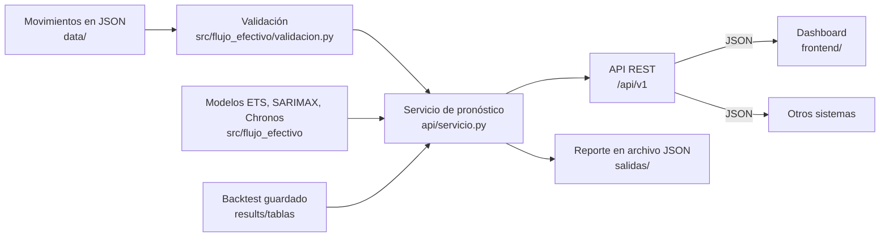
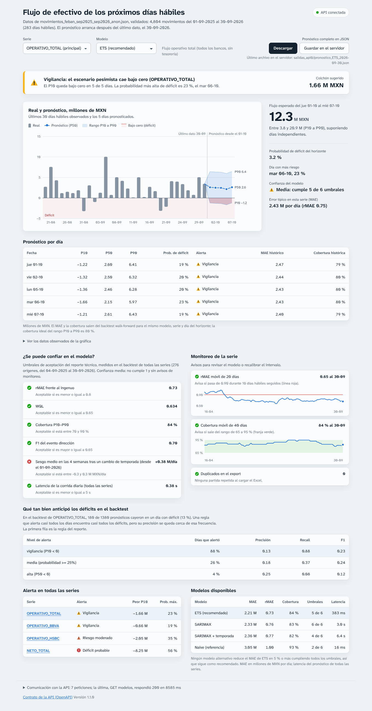
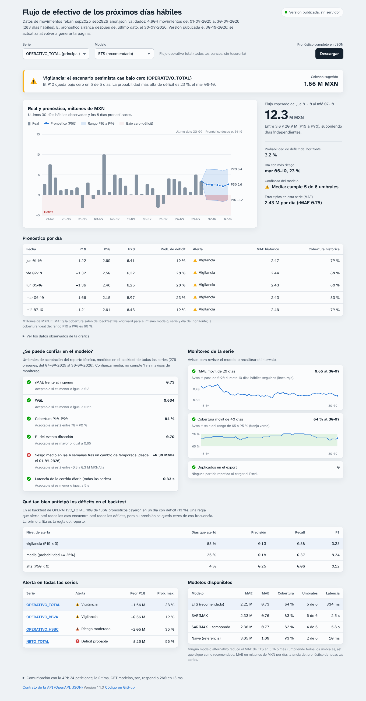
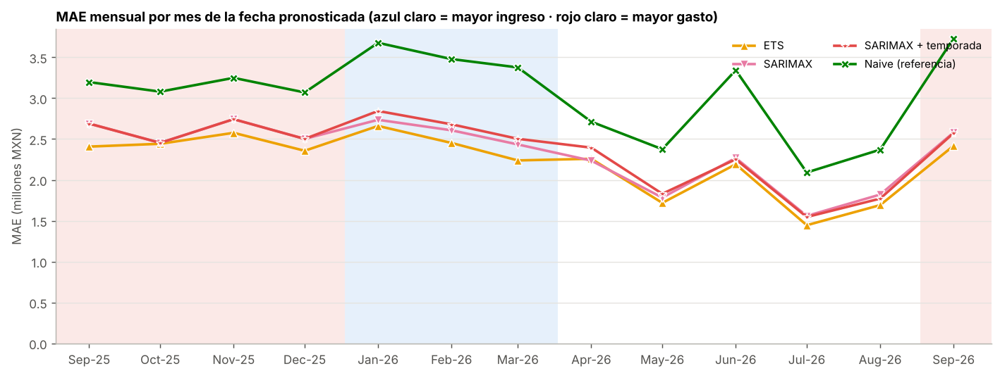
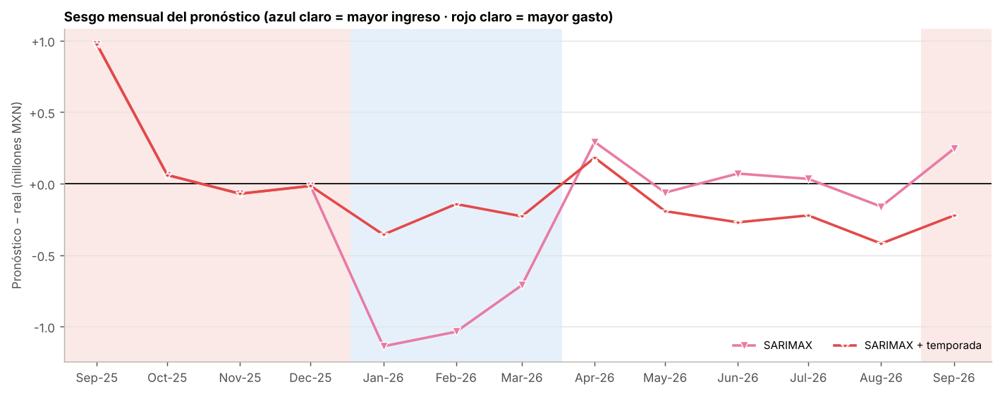

# Predictor de flujo de efectivo con modelos de Hugging Face

[](https://<usuario>.github.io/predictor-flujo-efectivo/)
[](https://github.com/<usuario>/predictor-flujo-efectivo/actions/workflows/pruebas.yml)
[](https://github.com/<usuario>/predictor-flujo-efectivo/actions/workflows/docker.yml)
[](https://colab.research.google.com/github/<usuario>/predictor-flujo-efectivo/blob/main/notebooks/predictor_flujo_efectivo_chronos.ipynb)

En este proyecto construí un predictor del flujo de efectivo diario a partir de los movimientos bancarios que exporta SAP en la transacción FEBAN. Comparo dos modelos fundacionales de series de tiempo publicados en Hugging Face, Chronos-2 y Chronos-Bolt Small, contra dos modelos estadísticos clásicos, ETS y SARIMAX, y contra un pronóstico ingenuo que repite el último día observado. El pronóstico se consume a través de un backend con una API REST, que lee los movimientos de un archivo JSON validado y entrega P10, P50 y P90 por día, la alerta de déficit y las métricas de confianza, tanto en un dashboard web como en un archivo JSON.

## Descripción del proyecto

Tesorería necesita saber cuánto efectivo va a entrar y salir en los próximos días para decidir traspasos entre bancos, inversiones de excedentes y pagos. El punto de partida es un export FEBAN con los movimientos de una cuenta en BBVA y otra en HSBC, del 01-09-2025 al 30-09-2026. Solo una semana es real; el resto lo completé con datos ficticios coherentes con esa semana, con más ingreso de enero a marzo y más gasto de septiembre a diciembre. En [`data/README.md`](data/README.md) explico cómo se armó el archivo y cómo lo anonimicé.

Antes de pronosticar, el pipeline elimina las partidas repetidas por cargas múltiples del mismo extracto y separa los movimientos de tesorería (barridos, inversiones en fondos y traspasos entre bancos propios), porque no son flujo del negocio. Con lo que queda arma cuatro series en días hábiles: `OPERATIVO_TOTAL`, que es la serie principal, `OPERATIVO_BBVA`, `OPERATIVO_HSBC` y `NETO_TOTAL`, que incluye la tesorería.

| Modelo | Tipo | Fuente | Tamaño | Licencia |
|---|---|---|---|---|
| Chronos-2 | Fundacional *zero-shot*, univariado y multivariado, con covariables | [`amazon/chronos-2`](https://huggingface.co/amazon/chronos-2) | 120 M de parámetros | Apache-2.0 |
| Chronos-2 + temporada | Chronos-2 con la covariable de temporada en `future_df` | mismos pesos | 120 M | Apache-2.0 |
| Chronos-2 (cross-learning) | Chronos-2 pronosticando las cuatro series en conjunto | mismos pesos | 120 M | Apache-2.0 |
| Chronos-Bolt Small | Fundacional *zero-shot*, univariado | [`amazon/chronos-bolt-small`](https://huggingface.co/amazon/chronos-bolt-small) | 48 M de parámetros | Apache-2.0 |
| ETS | Suavizamiento exponencial con error aditivo, tendencia amortiguada y ciclo de 5 días | `statsmodels` | cerca de 10 parámetros por serie | BSD-3-Clause |
| SARIMAX | ARIMA estacional con regresores de calendario | `statsmodels` | cerca de 11 parámetros por serie | BSD-3-Clause |
| SARIMAX + temporada | SARIMAX con la covariable de temporada en `exog` | `statsmodels` | cerca de 13 parámetros por serie | BSD-3-Clause |
| Ingenuo (referencia) | Mañana igual a hoy | | | |

La covariable de temporada son dos indicadores que se conocen de antemano: ingreso alto de enero a marzo y gasto alto de septiembre a diciembre. Comparar cada modelo con y sin ella muestra si anticipa el cambio de temporada o lo detecta tarde. Solo la uso en un origen cuando la historia ya contiene al menos 10 días hábiles de cada temporada que aparece en el horizonte, para que el modelo no extrapole a una temporada que nunca ha visto.

La evaluación es un backtest *walk-forward*: en cada uno de 276 orígenes, cada modelo usa solo la historia hasta ese día y pronostica los siguientes 5 días hábiles, lo que da 5,520 pronósticos por modelo. Mido el error con MAE, sesgo, RMSE, sMAPE, el MAE relativo al ingenuo (rMAE) y, para los cuantiles P10, P50 y P90, la pérdida de cuantiles ponderada (WQL) y la cobertura del intervalo. Como el ejercicio pedía accuracy, precision, recall y F1, convierto cada pronóstico en la decisión que tomaría tesorería en tres eventos: si el flujo sube respecto al último día, si será un día de flujo alto y si habrá déficit. También mido la latencia por llamada, la carga del modelo, la memoria de GPU y cómo crece el tiempo con 1, 16 y 64 series, y separo las métricas antes y desde el 01-09-2026, cuando empieza la temporada de mayor gasto.

## Estructura del repositorio

```
predictor-flujo-efectivo/
├── README.md
├── GUIA_GITHUB.md                    cómo subir el proyecto y publicar la página
├── .github/workflows/
│   ├── pruebas.yml                   corre las pruebas en GitHub con cada cambio
│   └── docker.yml                    construye la imagen de Docker y la prueba
├── Dockerfile                        imagen del backend y el dashboard
├── compose.yaml                      arranque con Docker Compose
├── .dockerignore                     lo que no entra a la imagen
├── requirements.txt                  dependencias del cuaderno y de src/
├── requirements-api.txt              dependencias del backend y de las pruebas
├── api/                              backend (FastAPI)
│   ├── main.py                       endpoints, CORS y servidor del dashboard
│   ├── servicio.py                   datos, modelos, backtest en caché, pronósticos y reporte JSON
│   ├── alertas.py                    probabilidad y niveles de alerta de déficit
│   ├── confianza.py                  métricas, umbrales del reporte y monitoreo
│   ├── esquemas.py                   contrato de entrada y salida
│   ├── validar.py                    python -m api.validar: revisa un JSON de movimientos
│   ├── exportar.py                   python -m api.exportar: escribe el reporte JSON sin levantar la API
│   └── publicar.py                   python -m api.publicar: genera la página de GitHub Pages en docs/
├── frontend/                         dashboard (HTML, CSS y JavaScript sin dependencias)
├── docs/                             página publicada: el dashboard con las respuestas de la API en JSON
├── tests/                            pruebas de validación, API, página publicada y navegador
├── data/
│   ├── README.md                     origen, formato JSON, validación y anonimización
│   ├── DEPOSITOS_CARGADOS_FEBAN_sep2025_sep2026_anon.xlsx   entrada del cuaderno
│   ├── movimientos_feban_sep2025_sep2026_anon.json          entrada de la API (mismos movimientos)
│   └── esquema_movimientos.json      esquema del JSON de entrada
├── notebooks/
│   ├── predictor_flujo_efectivo_chronos.ipynb   cuaderno completo para Colab
│   └── api_dashboard_colab.ipynb                levanta la API y el dashboard en Colab
├── salidas/                          reportes JSON que escribe la API
├── src/
│   ├── ejecutar_backtest.py          corre todo y guarda results/
│   ├── excel_a_json.py               convierte un export FEBAN en Excel al JSON de la API
│   └── flujo_efectivo/
│       ├── config.py                 parámetros (celda 4.1 del cuaderno)
│       ├── datos.py                  lectura (Excel o JSON), deduplicación, clasificación y series
│       ├── validacion.py             validación del JSON de movimientos
│       ├── covariables.py            temporada y calendario
│       ├── modelos.py                Chronos, ETS, SARIMAX e ingenuo con una sola interfaz
│       ├── backtest.py               walk-forward y pronóstico hacia adelante
│       ├── metricas.py               regresión, clasificación y periodos
│       ├── latencia.py               latencia y escalabilidad
│       ├── graficas.py               figuras en PNG
│       ├── reporte.py                lectura de la corrida y exportación a Excel
│       └── entorno.py                GPU, semillas y versiones
└── results/
    ├── README.md
    ├── lectura_corrida.md
    ├── resultados_predictor_flujo.xlsx
    ├── corrida.json
    ├── tablas/                       CSV de cada tabla del cuaderno
    ├── figuras/                      PNG de cada gráfica
    └── capturas/                     el dashboard funcionando (escritorio, móvil, modo oscuro y versión publicada)
```

El cuaderno es la versión principal del trabajo. El código de `src/` es el mismo, separado en módulos para correrlo sin Jupyter; comprobé que los dos dan exactamente los mismos pronósticos para los modelos estadísticos.

## Entorno de ejecución

El cuaderno está pensado para Google Colab con GPU T4. En una T4 Chronos corre en `float32`, porque esa tarjeta no tiene soporte nativo de `bfloat16`; en L4 o A100 el cuaderno cambia solo a `bfloat16`. También funciona en CPU, porque los modelos son pequeños, aunque entonces la latencia de Chronos no es representativa. ETS y SARIMAX siempre corren en CPU.

Hace falta Python 3.10 o superior. Estas son las versiones con las que probé el código:

| Paquete | Versión |
|---|---|
| Python | 3.13 |
| chronos-forecasting | 2.3.2 |
| torch | 2.14.1 |
| transformers | 4.57.6 |
| huggingface_hub | 0.36.2 |
| statsmodels | 0.15.0 |
| scikit-learn | 1.9.1 |
| pandas | 3.0.5 |
| numpy | 2.5.3 |
| matplotlib | 3.11.2 |
| openpyxl | 3.1.5 |
| fastapi | 0.160.0 |
| uvicorn | 0.53.0 |

Los dos modelos de Hugging Face son públicos, así que el token es opcional. Autenticarse evita los límites de descarga anónima; en Colab se guarda en Secrets con el nombre `HF_TOKEN` y en local se define como variable de entorno.

Con la configuración por omisión, la parte estadística tarda unos 7 minutos en una CPU de 2 vCPU. El cuaderno completo en CPU tarda entre 15 y 30 minutos, casi todo por SARIMAX; Chronos en GPU tarda pocos minutos.

## Pasos de ejecución

### En Google Colab

1. Abre el cuaderno con el botón "Open in Colab" del inicio de esta página, o en `https://colab.research.google.com/github/<usuario>/predictor-flujo-efectivo/blob/main/notebooks/predictor_flujo_efectivo_chronos.ipynb`.
2. En *Entorno de ejecución → Cambiar tipo de entorno de ejecución* elige GPU T4.
3. Si tienes token de Hugging Face, guárdalo en Secrets como `HF_TOKEN` y dale acceso al cuaderno.
4. Para los datos, agrega una celda al inicio con `!git clone https://github.com/<usuario>/predictor-flujo-efectivo.git`; el cuaderno busca el Excel en `predictor-flujo-efectivo/data/`. Si no lo clonas, al llegar a la celda 4.2 te pide subir el archivo.
5. Ejecuta *Entorno de ejecución → Ejecutar todas*. Al terminar se descarga `resultados_predictor_flujo.xlsx` con todas las tablas.

### En local con Jupyter

```bash
git clone https://github.com/<usuario>/predictor-flujo-efectivo.git
cd predictor-flujo-efectivo
python -m venv .venv
source .venv/bin/activate          # en Windows: .venv\Scripts\activate
pip install -r requirements.txt
jupyter notebook notebooks/predictor_flujo_efectivo_chronos.ipynb
```

El cuaderno encuentra el Excel en `../data/`. La celda de instalación con `%pip` se puede saltar si ya instalaste `requirements.txt`.

### Desde la línea de comandos

```bash
python src/ejecutar_backtest.py                          # los ocho modelos
python src/ejecutar_backtest.py --sin-chronos            # solo ETS, SARIMAX e ingenuo, sin descargar pesos
python src/ejecutar_backtest.py --max-origenes 40 --sin-latencia   # prueba rápida
```

El script repite el flujo del cuaderno y guarda las tablas, las figuras, el Excel de resultados y un resumen de la corrida en `results/`. Estas son sus opciones:

| Opción | Uso |
|---|---|
| `--excel RUTA` | Otro export FEBAN con las mismas columnas |
| `--salida CARPETA` | Carpeta de resultados (por omisión `results/`) |
| `--sin-chronos` | Omite Chronos-2 y Chronos-Bolt Small |
| `--chronos2`, `--chronos-bolt` | Repositorio de Hugging Face o carpeta local con los pesos |
| `--horizonte N` | Días hábiles por pronóstico (5) |
| `--max-origenes N` | Orígenes del backtest (280; con este archivo hay 276) |
| `--fecha-corte AAAA-MM-DD` | Fecha que separa las métricas por periodo (2026-09-01) |
| `--sin-latencia` | No mide latencia ni escalabilidad |
| `--cpu` | Corre Chronos en CPU aunque haya GPU |

Los demás parámetros (cuantiles, meses de cada temporada, días mínimos para usar la covariable, frecuencia de re-estimación de SARIMAX y reglas para separar la tesorería) están en la celda 4.1 del cuaderno y en `src/flujo_efectivo/config.py`. Con otro export, lo primero que hay que revisar son las reglas de tesorería, con la lista de cuentas propias de la empresa.

## Backend y dashboard

El pronóstico no se queda en el cuaderno: un backend en FastAPI lee los movimientos de un archivo JSON, los valida, carga los modelos y el backtest, y expone todo en una API REST. Además de la salida visual del dashboard, escribe el pronóstico completo en un archivo JSON. El dashboard es una página web que solo habla con esa API, y cualquier otro sistema (el ERP, una hoja de cálculo, un script de tesorería) puede usar los mismos endpoints.



Al arrancar, el servicio lee el JSON de movimientos y lo valida; si falta algún dato necesario, no arranca y dice en qué movimiento y en qué campo está el problema. Después busca el backtest en `results/`. Solo lo usa si la huella SHA-256 de las series diarias coincide con la de `results/corrida.json` (es la misma si los movimientos llegan en Excel o en JSON); si no hay backtest para algún modelo, lo calcula en segundo plano y lo guarda en `api_cache/`. Mientras tanto, la API ya pronostica y el endpoint de métricas responde 503 con `Retry-After`. El pronóstico de cada modelo se calcula una vez y se guarda en memoria; la primera llamada mide la latencia que se compara contra el umbral del reporte.

### Endpoints

| Método | Ruta | Devuelve |
|---|---|---|
| GET | `/api/v1/salud` | Estado del servicio, datos cargados, modelos y estado de su backtest |
| GET | `/api/v1/series` | Series disponibles con su último valor |
| GET | `/api/v1/series/{serie}/historia?dias=60` | Valores diarios observados |
| GET | `/api/v1/pronostico?serie=&modelo=&horizonte=` | P10, P50 y P90 por día, probabilidad y nivel de alerta de cada día, error histórico de ese horizonte, flujo acumulado y alerta del horizonte |
| POST | `/api/v1/pronostico` | El mismo formato para una serie diaria que manda otro sistema |
| GET | `/api/v1/alertas?modelo=` | Alerta de déficit de todas las series |
| GET | `/api/v1/metricas?modelo=&serie=` | Métricas del backtest, umbrales del reporte, monitoreo y desempeño de la alerta |
| GET | `/api/v1/modelos` | Modelos lado a lado con los criterios de aceptación y de cambio de modelo |
| GET | `/api/v1/reporte?modelo=&descargar=` | El pronóstico completo de un modelo (todas las series, alertas y confianza) en un solo JSON; con `descargar=true` llega como archivo |
| POST | `/api/v1/reporte?modelo=` | Escribe ese reporte como archivo en `salidas/` y devuelve su ruta |
| GET | `/api/v1/datos/validacion` | Resultado de la validación del JSON cargado: avisos y resumen |
| POST | `/api/v1/datos/validar` | Valida un JSON de movimientos sin cargarlo: errores por movimiento y campo, y avisos |
| GET | `/docs` | Contrato OpenAPI interactivo |

Los montos van en pesos. Este es un día de la respuesta de `/api/v1/pronostico` para `OPERATIVO_TOTAL` con ETS:

```json
{
  "fecha": "2026-10-01", "h": 1,
  "p10": -1220904.77, "p50": 2596673.96, "p90": 6414252.68,
  "prob_deficit": 0.192,
  "alerta": {"nivel": "vigilancia", "activa": true},
  "confianza": {"mae": 2467656.29, "rmae": 0.759, "cobertura": 79.35, "sesgo": -74645.23, "n": 276}
}
```

Si la serie o el modelo no existen, la API responde 404 con la lista de opciones; si el horizonte está fuera de rango, 422. Todas las respuestas traen el encabezado `Server-Timing` con el tiempo del servidor, y CORS está abierto por omisión para que el dashboard pueda vivir en otro dominio.

### Entrada en JSON

La API ya no lee Excel: su entrada es `data/movimientos_feban_sep2025_sep2026_anon.json`, con los mismos 4,804 movimientos del Excel. Cada movimiento necesita fecha, monto, banco y concepto; partida, tipo de transacción, clave del extracto, regla contable y moneda son opcionales. La validación revisa los cuatro datos obligatorios y su tipo, que la historia cubra al menos 10 días hábiles y que haya flujo operativo, y avisa de duplicados, huecos sin movimientos, otras monedas y campos opcionales que faltan. Junta todos los problemas en una sola pasada:

```json
{"valido": false, "total_errores": 3, "errores": [
  {"fila": 1, "campo": "concepto", "mensaje": "Falta el dato obligatorio (concepto del banco; con él se separa la tesorería)."},
  {"fila": 2, "campo": "fecha", "mensaje": "Fecha no válida: '01/09/2026'. Usa el formato AAAA-MM-DD."},
  {"fila": 2, "campo": "monto", "mensaje": "El monto debe ser un número y llegó '10'."}]}
```

El formato completo, con la equivalencia de cada campo con los encabezados del export FEBAN, está en [`data/README.md`](data/README.md) y en `data/esquema_movimientos.json`. Para convertir otro export: `python src/excel_a_json.py export.xlsx movimientos.json`.

### Salida en archivo JSON

El reporte JSON reúne en un solo documento lo que el dashboard muestra en pantalla: para cada serie, los P10, P50 y P90 de cada día, la probabilidad y el nivel de alerta, el flujo acumulado, la alerta del horizonte con su colchón sugerido, y la confianza del modelo con sus umbrales y su monitoreo. La API lo escribe en `salidas/pronostico_<modelo>_<último día con datos>.json` al arrancar, en cuanto el modelo recomendado tiene pronóstico y backtest, y cada vez que alguien pide `POST /api/v1/reporte`. En el dashboard, el botón "Descargar" baja ese archivo para el modelo elegido y "Guardar en el servidor" lo escribe en `salidas/`. También se genera sin levantar la API, con `python -m api.exportar --modelo ETS`. El archivo y la respuesta de `GET /api/v1/reporte` son el mismo documento; [`salidas/README.md`](salidas/README.md) describe cada campo y `salidas/pronostico_ETS_2026-09-30.json` es el que se genera con los datos del repositorio.

### Alerta de déficit

La probabilidad de déficit de cada día sale de los tres cuantiles, con una normal que pasa por P10, P50 y P90 (para ETS y SARIMAX es exacta, porque su intervalo es gaussiano). Con ella, cada día recibe un nivel:

| Nivel | Condición | En el backtest de `OPERATIVO_TOTAL` con ETS |
|---|---|---|
| Vigilancia | P10 < 0, la regla del reporte | Alertó el 88 % de los días; precisión 0.13, recall 0.88 |
| Riesgo moderado | Probabilidad de déficit de 25 % o más | Alertó el 26 % de los días; precisión 0.18, recall 0.37 |
| Déficit probable | P50 < 0 | Alertó el 4 % de los días; precisión 0.25, recall 0.08 |

En ese backtest, el 13 % de los pronósticos cayó en un día con déficit. Al conectar la alerta con el backtest me di cuenta de que la regla que propuse en el reporte se activa casi todos los días en esta serie: el ruido diario es tan grande que el P10 casi siempre queda bajo cero, y su precisión no pasa de la frecuencia base. La API la conserva como nivel de vigilancia, agrega los dos niveles más severos para ordenar las alertas y entrega el colchón sugerido, que es el efectivo que cubre el peor P10 del horizonte. En la práctica, ese colchón es el dato que tesorería puede usar. La tabla de desempeño viaja en cada respuesta, para que quien vea la alerta sepa cuánto pesa.

### Métricas de confianza

Cada pronóstico trae el MAE, el rMAE y la cobertura histórica de su mismo horizonte y serie. El endpoint de métricas agrega los umbrales de aceptación del reporte (rMAE, WQL, cobertura P10–P90, F1 de dirección, sesgo en las cuatro semanas posteriores a un cambio de temporada y latencia), los disparadores de monitoreo (rMAE móvil de 20 días, cobertura móvil de 40 días y duplicados en el export) y un nivel de confianza: alta si cumple todo, media con una falla o aviso, baja con más. ETS queda en confianza media, porque cumple cinco de los seis umbrales y falla el de sesgo tras el cambio de temporada, igual que en el reporte.

### Cómo levantarlo

En Colab, sin instalar nada en la computadora: abre [`notebooks/api_dashboard_colab.ipynb`](https://colab.research.google.com/github/<usuario>/predictor-flujo-efectivo/blob/main/notebooks/api_dashboard_colab.ipynb) y ejecuta todas las celdas. El cuaderno clona el repositorio (o pide el zip), instala `requirements-api.txt`, arranca la API, la consulta desde Python y muestra el dashboard dentro de Colab, además de un enlace para abrirlo en otra pestaña.

En local:

```bash
pip install -r requirements-api.txt
python -m api.validar data/movimientos_feban_sep2025_sep2026_anon.json   # opcional: revisar la entrada
uvicorn api.main:app --port 8000
python -m api.exportar --modelo ETS                                    # opcional: solo el archivo JSON
```

El dashboard queda en `http://localhost:8000/` y el contrato en `http://localhost:8000/docs`. También se puede levantar con Docker, sin instalar Python (sección siguiente). Para servir el frontend por separado, basta indicarle dónde está la API:

```bash
python -m http.server 8080 --directory frontend
# abrir http://localhost:8080/?api=http://localhost:8000/
```

| Variable de entorno | Uso |
|---|---|
| `FLUJO_DATOS` | Otro archivo JSON de movimientos |
| `FLUJO_SALIDAS` | Carpeta donde se escribe el reporte JSON (por omisión, `salidas/`) |
| `FLUJO_MODELO` | Modelo recomendado (ETS) |
| `FLUJO_CHRONOS` | `1` para cargar Chronos-2 y Chronos-Bolt Small; requiere `requirements.txt` y acceso a Hugging Face o pesos locales |
| `FLUJO_CHRONOS2`, `FLUJO_CHRONOS_BOLT` | Repositorio o carpeta de cada modelo |
| `FLUJO_CORS` | Orígenes permitidos, separados por coma (por omisión, todos) |
| `FLUJO_UMBRAL_DEFICIT` | Umbral de déficit en pesos (0) |

### Pruebas de comunicación

```bash
python -m pytest tests -q
CAPTURAS=results/capturas python -m pytest tests/test_e2e.py -q   # además guarda capturas del dashboard
```

Las pruebas de validación (`tests/test_validacion.py`) revisan cada dato obligatorio, la estructura del archivo, la historia mínima, las monedas y los avisos, y que el JSON y el Excel den las mismas series. Las pruebas de contrato (`tests/test_api.py`) revisan cada endpoint contra su esquema, que los cuantiles de la API sean idénticos a los del paquete de modelos, que las métricas reproduzcan las tablas de `results/`, que la alerta siga la regla del P10, que el reporte escrito en archivo sea idéntico a la respuesta de la API, que el servicio no arranque con un JSON incompleto o con un Excel, que los errores lleguen con un mensaje claro, que CORS responda y que, sin backtest, la API siga pronosticando y avise con 503. Las pruebas de la página publicada (`tests/test_pagina.py`) generan `docs/`, comparan sus archivos con las respuestas de la API y abren el dashboard como si estuviera en `usuario.github.io/predictor-flujo-efectivo/`, sin servidor. La prueba en navegador (`tests/test_e2e.py`) levanta la API con uvicorn, abre el dashboard en Chromium y comprueba que los números de la tabla son los mismos que entrega la API, que al cambiar de serie y de modelo se hacen las peticiones correctas, que el frontend funciona servido desde otro origen, que los botones de descarga y de guardado producen el mismo reporte que la API, que muestra un error claro si la API no responde y que no hay desplazamiento horizontal en móvil. Las 67 pruebas pasan; la del navegador se omite si Playwright no está instalado.



## Ejecutar con Docker

El `Dockerfile` arma una imagen con el backend, el dashboard, los datos en JSON, el backtest guardado y las pruebas, sobre `python:3.12-slim`. Sirve los modelos estadísticos (ETS, SARIMAX y el ingenuo); Chronos necesita GPU y se corre en el cuaderno. Dentro del contenedor la API corre con un usuario sin privilegios (UID 1000) y solo escribe en `salidas/` y `api_cache/`.

Se necesita Docker: Docker Desktop en Windows o Mac, o Docker Engine en Linux. Sin poder instalar nada, la opción más sencilla es GitHub Codespaces, que trae Docker y corre en el navegador: en el repositorio, "Code", "Codespaces", "Create codespace on main", y en la terminal que se abre se ejecutan los mismos comandos de esta sección. Codespaces avisa cuando el puerto 8000 está listo y lo abre en otra pestaña (también aparece en la pestaña "Ports").

### Construir y ejecutar

Desde la carpeta del repositorio:

```bash
docker build -t predictor-flujo-efectivo .
docker run --rm -p 8000:8000 predictor-flujo-efectivo
```

La primera construcción descarga la imagen base e instala las dependencias; las siguientes reutilizan esa capa mientras no cambie `requirements-api.txt`. Con el contenedor corriendo, el dashboard está en `http://localhost:8000/` y el contrato de la API en `http://localhost:8000/docs`. Se detiene con Ctrl + C. La imagen trae una revisión de salud: `docker ps` muestra el contenedor como `healthy` cuando la API ya responde.

### Con Docker Compose

`compose.yaml` hace lo mismo y además monta `salidas/` en la carpeta del repositorio, así que el reporte JSON que escribe la API al arrancar aparece ahí:

```bash
docker compose up --build        # agrega -d para dejarlo en segundo plano
docker compose logs -f           # ver el registro
docker compose down              # detenerlo
```

### Salida JSON, otros datos y comandos

Con `docker run`, el reporte JSON se queda dentro del contenedor salvo que se monte una carpeta. En PowerShell se cambia `$(pwd)` por `${PWD}`:

```bash
# guardar en ./salidas el reporte que escribe la API
docker run --rm -p 8000:8000 -v "$(pwd)/salidas:/app/salidas" predictor-flujo-efectivo

# usar otro JSON de movimientos: se monta su carpeta y se indica con FLUJO_DATOS
docker run --rm -p 8000:8000 -v "$(pwd)/mis_datos:/datos:ro" -e FLUJO_DATOS=/datos/movimientos.json predictor-flujo-efectivo
```

Si el JSON no tiene lo necesario para pronosticar, el contenedor no arranca y su registro lista cada problema con su movimiento y su campo. Con datos nuevos, el backtest de cada modelo se calcula en segundo plano; para no repetirlo en cada arranque, conviene montar también un volumen en `/app/api_cache` (Compose ya lo hace).

Los comandos del proyecto también corren en la imagen, sin levantar la API:

```bash
docker run --rm -v "$(pwd)/mis_datos:/datos:ro" predictor-flujo-efectivo python -m api.validar /datos/movimientos.json
docker run --rm -v "$(pwd)/salidas:/app/salidas" predictor-flujo-efectivo python -m api.exportar --modelo SARIMAX
docker run --rm -v "$(pwd)/docs:/app/docs" predictor-flujo-efectivo python -m api.publicar
docker run --rm predictor-flujo-efectivo python -m pytest tests -q
```

En el último comando, las dos pruebas de navegador se omiten porque la imagen no trae Chromium; las demás deben pasar. Las variables de entorno de la tabla de arriba (`FLUJO_MODELO`, `FLUJO_UMBRAL_DEFICIT`, `FLUJO_CORS`, etc.) se pasan con `-e`. Para usar otra versión de Python: `docker build --build-arg IMAGEN_PYTHON=python:3.13-slim -t predictor-flujo-efectivo .`

En Linux, si la carpeta montada pertenece a otro usuario y la API no puede escribir en ella, se le da permiso al UID del contenedor con `sudo chown 1000 salidas` o se corre el contenedor con el usuario propio: `--user "$(id -u)"`. En GitHub, el flujo `.github/workflows/docker.yml` construye la imagen con cada cambio, corre las pruebas dentro del contenedor y comprueba que la API arranca y queda `healthy`.

## Página publicada en GitHub Pages

GitHub Pages solo sirve archivos, así que no puede correr la API. La página publicada es el mismo dashboard en modo estático: `python -m api.publicar` levanta la API en memoria, le pide cada respuesta que usa el dashboard (las cuatro series con los cuatro modelos) y guarda cada una como archivo en `docs/api/v1/`. El dashboard detecta que es la versión publicada y lee esos archivos en lugar de llamar al servidor; todo lo demás funciona igual, incluida la descarga del reporte JSON. Lo único que no está es "Guardar en el servidor", porque no hay servidor.

Los mismos archivos quedan a la mano para cualquier otro sistema, con direcciones fijas:

| Dato | Dirección dentro de la página |
|---|---|
| Pronóstico de una serie con un modelo | `api/v1/pronostico/OPERATIVO_TOTAL/ETS.json` |
| Métricas de confianza | `api/v1/metricas/OPERATIVO_TOTAL/ETS.json` |
| Alerta de todas las series | `api/v1/alertas/ETS.json` |
| Reporte completo | `api/v1/reporte/ETS.json` |
| Contrato de la API | `api/openapi.json` |

La página muestra los datos con los que se generó y la fecha de publicación. Para actualizarla se vuelve a correr `python -m api.publicar` (o la última sección del cuaderno de Colab) y se sube la carpeta `docs/` otra vez. Los pasos para subir el repositorio y activar la página, todos desde el navegador, están en [`GUIA_GITHUB.md`](GUIA_GITHUB.md).



## Resultados

Los resultados de [`results/`](results/) salen del script en CPU. Los de Chronos-2 y Chronos-Bolt Small están pendientes: en el entorno donde armé el repositorio no pude descargar los pesos, así que solo validé su código con modelos diminutos de pesos aleatorios. Para completarlos hay que correr el cuaderno en Colab o el script en una máquina con acceso a Hugging Face.

| Modelo | MAE (M MXN) | rMAE | MAE desde 01-09-2026 (M MXN) | WQL | Cobertura P10–P90 | F1 dirección | Latencia mediana |
|---|---|---|---|---|---|---|---|
| ETS | 2.21 | 0.73 | 2.42 | 0.634 | 84 % | 0.70 | 0.24 s |
| SARIMAX | 2.33 | 0.76 | 2.58 | 0.650 | 83 % | 0.68 | 2.34 s |
| SARIMAX + temporada | 2.36 | 0.77 | 2.57 | 0.650 | 82 % | 0.69 | 5.40 s |
| Ingenuo (referencia) | 3.05 | 1.00 | 3.73 | 1.018 | 93 % | 0.00 | 0.01 s |
| Chronos-2 (tres variantes) | pendiente | | | | | | |
| Chronos-Bolt Small | pendiente | | | | | | |

El MAE se mide sobre las cuatro series y los cinco pasos del horizonte. La latencia es por llamada, pronosticando las cuatro series con toda la historia.



En todos los modelos el error es mayor en las dos temporadas marcadas que en los meses normales, y ETS tiene el menor error en 12 de los 13 meses; la excepción es abril, donde SARIMAX queda apenas por debajo.



Sin la covariable, SARIMAX subestimó el flujo de enero a marzo y lo sobreestimó al entrar a septiembre de 2026. Con ella, el sesgo promedio de enero a marzo baja de −0.96 a −0.24 M MXN diarios y en septiembre cambia de signo, aunque el MAE de esos meses no mejora.

## Conclusiones

Este ejercicio me permitió construir de principio a fin un predictor de flujo de efectivo a partir de movimientos bancarios y comparar dos modelos fundacionales de Hugging Face, Chronos-2 y Chronos-Bolt Small, contra ETS y SARIMAX. Lo primero que aprendí es que la preparación de los datos pesa tanto como el modelo. El export FEBAN repetía cada partida tantas veces como cargas tenía el extracto, lo que inflaba el flujo entre 6 y 19 veces. Además, tuve que separar los barridos, las inversiones en fondos y los traspasos entre bancos, porque son decisiones de tesorería y no flujo del negocio.

De los modelos que pude medir, ETS fue el mejor. Tuvo un error medio de 2.21 M MXN por pronóstico, 27 % menos que el pronóstico ingenuo, el mejor intervalo y menos de medio segundo por corrida en CPU. SARIMAX, con y sin covariable, tardó entre 10 y 23 veces más y tuvo más error. Me sorprendió que la diferencia de precisión entre modelos fuera de apenas 7 %, frente a una diferencia de costo tan grande. Con un ruido diario cercano a 3 M MXN y casi sin memoria de un día a otro, lo más que puede hacer un modelo es estimar bien el nivel del flujo, y en ese terreno uno sencillo compite muy bien.

La covariable de temporada no mejoró el error promedio de SARIMAX, pero sí corrigió su sesgo al entrar a la temporada de mayor gasto: en septiembre pasó de sobreestimar 0.24 M MXN diarios a subestimar 0.22. También vi que una covariable mal planteada empeora el modelo. En la primera versión, SARIMAX extrapoló en abril y su error de ese mes subió de 2.24 a 3.26 M MXN, por lo que limité su uso a temporadas que ya aparecen en la historia.

El trabajo tiene dos limitaciones. La mayor parte de la historia es simulada, porque solo contaba con seis días hábiles de datos reales, y los modelos Chronos todavía no se evalúan con sus pesos publicados en GPU. Por eso recomiendo ETS para producción y dejo a Chronos-2 con covariable de temporada como alternativa, que solo lo sustituiría si reduce el error al menos 5 % y cumple los umbrales que definí. Como siguiente paso quiero repetir el pipeline con un año de movimientos reales y agregar como covariables los flujos que tesorería conoce de antemano, para ver si Chronos-2 los aprovecha mejor que los métodos clásicos.

## Confidencialidad de los datos

El Excel y el JSON del repositorio están anonimizados: los nombres de clientes y proveedores, las cuentas CLABE y los números de cuenta y contrato que traían los conceptos bancarios se cambiaron por valores ficticios, sin tocar importes, fechas ni las palabras que usa la clasificación. Los exports originales no se suben; el `.gitignore` excluye cualquier export FEBAN, en Excel o en JSON, que no termine en `_anon`.

## Referencias

- Amazon. (s. f.). *amazon/chronos-2* [Ficha del modelo]. Hugging Face. https://huggingface.co/amazon/chronos-2
- Amazon. (s. f.). *amazon/chronos-bolt-small* [Ficha del modelo]. Hugging Face. https://huggingface.co/amazon/chronos-bolt-small
- Seabold, S. y Perktold, J. (2010). Statsmodels: Econometric and statistical modeling with Python. *Proceedings of the 9th Python in Science Conference*.
